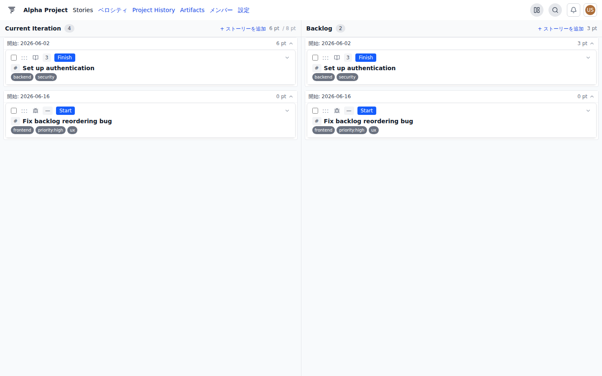
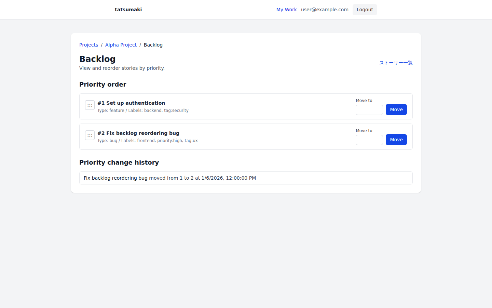
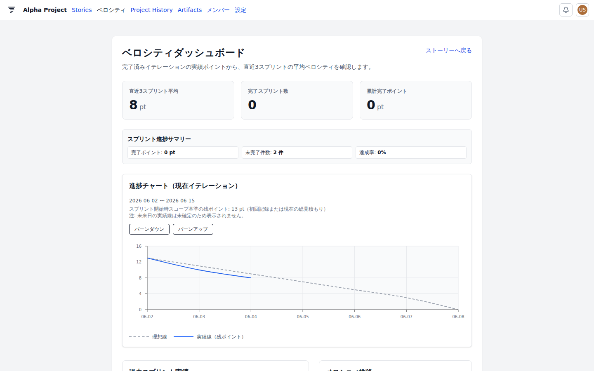
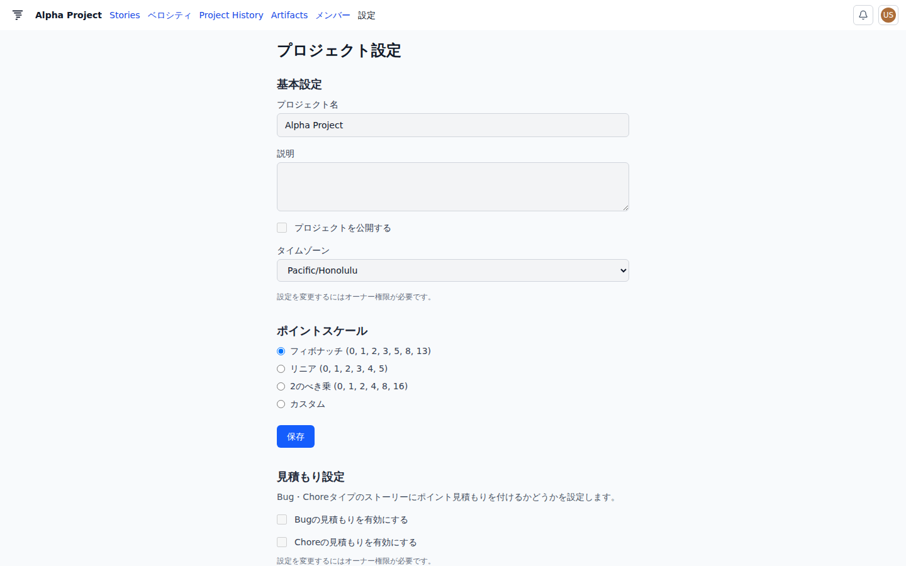
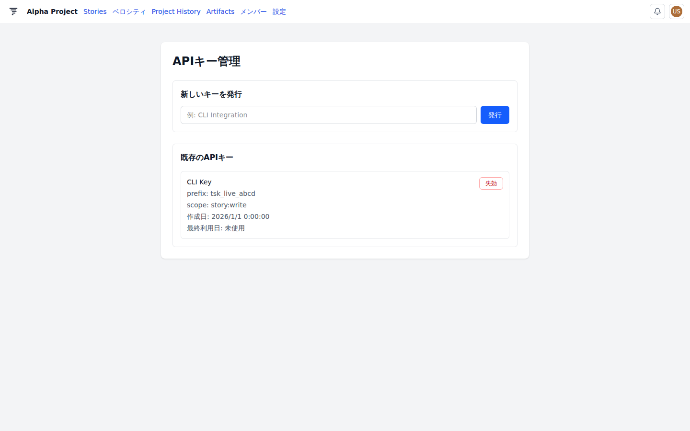

# tatsumaki

[Japanese README](README.ja.md)

tatsumaki is an agile project management tool for small Scrum teams that want a fast, story-centered workflow with point estimation, velocity tracking, and backlog forecasting.

The project is inspired by the workflow strengths of Pivotal Tracker, while being built as self-hostable open source software for modern web, CLI, and automation workflows.



## Features

- Manage user stories and tasks, including creation, prioritization, and status transitions.
- Plan iterations and track velocity using a Pivotal Tracker-style workflow.
- Forecast backlog completion from team velocity.
- Use the CLI for local operations and automation.
- Synchronize with GitHub Issues in both directions.

## Current Status

tatsumaki is pre-1.0 software. It is suitable for evaluation, local development, and early self-hosted use, but deployment and operations still expect familiarity with Cloudflare Workers, D1, KV, R2, and Cloudflare Access.

## Screenshots

| Stories | Velocity |
|---|---|
|  |  |

| Project settings | API keys |
|---|---|
|  |  |

## Tech Stack

- **API**: Cloudflare Workers + Cloudflare D1
- **CLI**: `tatsumaki` command
- **Desktop**: Electron viewer shell + CLI refetch IPC

Desktop implementation guide: [docs/desktop-app.md](docs/desktop-app.md)

## Quick Start

```bash
bash .claude/skills/self-hosting-setup/scripts/safe-local-setup.sh
bun run dev
```

Open `http://localhost:8787`. Local development uses `apps/web/wrangler.dev.toml`, including local dev auth as `dev@localhost`.

For an agent-guided setup from local first run through Cloudflare self-hosting readiness, use the repository skill `self-hosting-setup`.

## Self-Hosting Outline

1. Clone this repository and install dependencies with `bun install`.
2. Create a scoped Cloudflare API token and note your Account ID and Access team domain.
3. Run the setup command below with an explicitly allowed email address or email domain.
4. Optionally configure a production custom domain or route in the Worker dashboard.

## Deployment Configuration

The bootstrap command creates or reuses the Worker, D1 database, KV namespace, three R2 buckets (story attachments, user avatars, artifacts), Durable Object migration, Cloudflare Access application and allow policy, a second Access application with a bypass policy for `/artifact-content/*`, applies D1 migrations, deploys the Worker, and sets its Access values and a freshly generated `ARTIFACT_CONTENT_SIGNING_KEY`. Production is the default:

```bash
CLOUDFLARE_API_TOKEN=... CLOUDFLARE_ACCOUNT_ID=... CLOUDFLARE_ACCESS_TEAM_DOMAIN=your-team.cloudflareaccess.com bun apps/web/scripts/setup-cloudflare.ts --allow-email you@example.com
```

Use `--allow-domain example.com` instead of, or in addition to, `--allow-email`. To preview every action without contacting Cloudflare, append `--dry-run`.

The API token needs these account permissions:

- D1 Write
- Workers KV Storage Write
- Workers R2 Storage Write
- Workers Scripts Write
- Access: Apps and Policies Write

The setup command reads the token only from the environment and never writes account IDs, resource IDs, Access values, or secrets into the repository.

### Optional staging environment

Append `--with-staging` to create both production and a fully isolated staging environment in the same run:

```bash
CLOUDFLARE_API_TOKEN=... CLOUDFLARE_ACCOUNT_ID=... CLOUDFLARE_ACCESS_TEAM_DOMAIN=your-team.cloudflareaccess.com bun apps/web/scripts/setup-cloudflare.ts --allow-email you@example.com --with-staging
```

Staging uses its own `tatsumaki-staging` Worker, D1 database, KV namespace, R2 buckets, Durable Object storage, Access application, and Access policy. It does not share production data.

Artifact previews are served from `/artifact-content/<token>/...`, which is exempted from the Access login and authorized only by a 10-minute signed token. The setup command regenerates `ARTIFACT_CONTENT_SIGNING_KEY` on every run, so previews that are already open must be reloaded afterwards. To rotate the key by hand, set the old value as `ARTIFACT_CONTENT_SIGNING_KEY_PREVIOUS` while the new one rolls out.

For an existing installation, use `--staging-only` to create, repair, or redeploy staging without looking up, migrating, deploying, or changing any production resource:

```bash
CLOUDFLARE_API_TOKEN=... CLOUDFLARE_ACCOUNT_ID=... CLOUDFLARE_ACCESS_TEAM_DOMAIN=your-team.cloudflareaccess.com bun apps/web/scripts/setup-cloudflare.ts --allow-email you@example.com --staging-only
```

`--with-staging` and `--staging-only` are mutually exclusive. Add `--dry-run` first to confirm that only the `[staging]` plan is shown.

Hosted operators can optionally connect only the staging Worker to a private WorkerEntrypoint RPC service. Add `--staging-control-plane-service <worker-name>` together with `--staging-only` or `--with-staging`. The option is rejected for production-only setup, and self-hosted installations that omit it continue to use unlimited local entitlements.

The command is restartable. It looks up resources by their exact names and reuses them, so after a network error or permission fix, run the same command again. It will not create duplicate named resources. A different `--name-prefix` can be used when an account already uses the default names for another installation.

`apps/web/wrangler.toml` remains the public reference configuration for later manual deploys. It contains no account-specific IDs or secrets. The existing `bun run deploy:web` command applies production D1 migrations before publishing and preserves dashboard-managed variables.

For hosted continuous deployment, set the non-secret build environment variables `CONTROL_PLANE_SERVICE`, `CLOUDFLARE_D1_DATABASE_ID`, and `CLOUDFLARE_OAUTH_KV_NAMESPACE_ID`. Both `deploy:worker` and `deploy:upload` generate a temporary config with the hosted resource IDs, the `CONTROL_PLANE` Service Binding, and `ENTITLEMENT_MODE=control-plane`. Account-specific IDs remain outside Git, and omitted hosted values keep the base self-hosted config unchanged. See the [deployment reference](.claude/skills/self-hosting-setup/references/cloudflare-self-hosting.md#hosted-continuous-deployment) for preflight and Cloudflare Builds settings.

References:

- [Cloudflare Access applications API](https://developers.cloudflare.com/api/resources/zero_trust/subresources/access/subresources/applications/methods/create/)
- [Cloudflare D1 database API](https://developers.cloudflare.com/api/resources/d1/subresources/database/methods/create/)
- [Cloudflare KV namespaces API](https://developers.cloudflare.com/api/resources/kv/subresources/namespaces/methods/create/)
- [Cloudflare R2 buckets API](https://developers.cloudflare.com/api/resources/r2/subresources/buckets/methods/create/)
- [Cloudflare Wrangler configuration](https://developers.cloudflare.com/workers/wrangler/configuration/)

## Artifacts

An artifact is a project-scoped snapshot of a built static site (HTML, CSS, JavaScript, images, fonts) that project members open in tatsumaki. It is published only with the CLI; the Web lists and previews it read-only.

Put a `tatsumaki-artifact.json` in the build directory:

```json
{ "schemaVersion": 1, "entrypoint": "index.html", "exclude": ["**/*.map"] }
```

```bash
tm artifact create --project <project> --title "Release report" --path ./dist
tm artifact update <artifact-id> --project <project> --path ./dist --base-version 1
tm artifact download <artifact-id> --project <project> --version 1 --out ./restored
```

- `--project` can be omitted: it falls back to `TATSUMAKI_PROJECT_ID`, then `project_id` in the nearest `tatsumaki.toml` (see `apps/cli/README.md`).
- Every update is an immutable version with a fixed URL (`/projects/<project>/artifacts/<id>/versions/<n>`) and a latest URL. Sending an identical tree is a no-op; changing the title or archiving does not create a version.
- An update needs `--base-version`. If a newer version exists it fails with a conflict instead of overwriting it; there is no force option and no rollback command (download the old version and update from it).
- The CLI rejects the whole upload for sensitive files (`.git`, `.env*`, keys, certificates, credential-like files), symlinks and unsafe paths. Limits: 50 MiB in total, 25 MiB per file, 1,000 files.
- The page is untrusted and runs in an isolated sandbox with no network access (`connect-src none`), cookies, storage, popups, downloads or clipboard. Use relative asset paths and hash routing (`#/route`), because a version is served under a signed token path; external CDNs, remote images and web fonts do not load.
- Owners and members can publish; viewers can read and download. Project API keys use the `artifact:read` and `artifact:write` scopes.

## Target Users

tatsumaki is built for Scrum teams practicing agile development.

---

## Development Setup

### Initial Setup

```bash
# 1. Install dependencies. This also registers lefthook Git hooks.
bun install

# 2. Confirm lefthook is available.
bunx lefthook run pre-commit
```

> **Note**: `bun install` runs the root `postinstall`, which synchronizes `.agents/skills/*` symlinks into `.claude/skills/*`. Run `bun run agent-skills:sync` only when syncing manually. The lefthook `postinstall` also registers Git hooks, so a manual `bunx lefthook install` is not required.

### Quality Gates

This repository uses **lefthook** Git hooks for quality gates.

| Timing | Hook | Checks |
|---|---|---|
| `git commit` | **pre-commit** | config-guard for protected configuration, secret files, and destructive operations; conditional `lint:custom`; automatic code formatting |
| `git push` | **pre-push** | config-guard for pushed diffs, then lint -> openapi-check -> test -> typecheck with fail-fast execution |

### Daily Development Workflow

1. **Edit code** as usual.
2. **Commit** with `git commit`; the pre-commit hook runs automatically.
   - Changes to quality gate configuration files such as `lefthook.yml` and `biome.json` are blocked.
   - Secret files such as `.env`, credentials, and key files are blocked.
   - Diffs containing destructive operations, dangerous deletion, or destructive SQL are blocked.
   - `lint:custom` runs only when staged files match `apps/web/src/domain/**/*.ts(x)`.
   - Staged files are formatted with biome.
3. **Push** with `git push`; the pre-push hook runs automatically.
   - config-guard checks the pushed diff again to prevent pre-commit bypasses.
   - `bun run lint`, `bun run openapi:check`, `bun run test`, and `bun run typecheck` run in order.
   - Pushes are rejected unless every check passes.

### Handling Quality Check Failures

#### If pre-commit fails

```bash
# Formatting failure: stage the automatically fixed files, then commit again.
git add -u
git commit

# config-guard block:
# If the change is valid, follow the exception process in docs/config-guard.md.
```

#### If pre-push fails

```bash
# 1. Check which gate failed in the error output.

# 2. Re-run individual checks to isolate the cause.
bun run typecheck      # TypeScript typecheck
bun run lint           # Static analysis
bun run openapi:check  # OpenAPI drift detection
bun run test           # Tests

# 3. Fix the cause, commit the change, and push again.
git add <fixed-files>
git commit -m "fix: ..."
git push
```

#### If a hook blocks the change

Do not use `--no-verify` with `git commit` or `git push`. If config-guard blocks a valid configuration change, follow the exception process in [docs/config-guard.md](docs/config-guard.md).

### Manual Quality Checks

```bash
bun run typecheck      # TypeScript typecheck (tsc)
bun run lint           # Static analysis (oxlint + project custom lint)
bun run lint:custom    # Project custom lint only
bun run test           # Tests (vitest)
bun run format         # Format all files (biome)
bun run format:staged  # Format staged files only
```

### Local UI Verification Seed Data

When you need enough local D1 data for scroll verification, seed dummy data with:

```bash
# Default: 20 projects x 40 stories each
bun run seed:scroll

# Custom count: 3 projects x 300 stories each
bun run seed:scroll 3 300
```

Re-running the command replaces existing seed data with the `seed-scroll-*` prefix.

See [docs/agent-custom-linter-strategy.md](docs/agent-custom-linter-strategy.md) for the custom linter strategy and operations guide.

## Web E2E Strategy

Web E2E tests should prioritize the **accessibility tree with role/name selectors**, with screenshot assertions used as supporting checks. See the [Web E2E strategy guide](docs/web-e2e-strategy.md) for the policy and for the split between agent-generated tests and deterministic CI execution.

### UI Screenshot Diff Workflow

The `ui-screenshot-diff` job in `.github/workflows/ci.yml` runs on every PR and compares key screen screenshots against baseline images. When a diff exists, the job fails and uploads the comparison output as a `ui-screenshot-diff` artifact containing actual, expected, and diff images.

CI does not update screenshot baselines automatically. Linux CI is the sole screenshot generation and comparison environment; local execution and macOS baselines are not part of this workflow. For intentional UI changes, review the CI artifact's actual images, update the Linux baselines, and rerun CI.

Use the [UI screenshot test operations guide](docs/ui-screenshot-test-guide.md) for the standard failure triage process.

### Screenshot Capture Rules

- UI screenshots use **full page screenshots** by default.
- Playwright tests should use `expect(page).toHaveScreenshot(...)` and keep `expect.toHaveScreenshot.fullPage: true` in `apps/web/playwright.config.ts`.
- New UI screenshot tests must follow this setting and compare full pages.
- Do not resolve screenshot diff failures by deleting or skipping tests. Always isolate and fix the cause.

### Baseline Update Procedure

When a UI change is intentional, inspect the `ui-screenshot-diff` CI artifact, use its reviewed actual images as the updated baselines, commit them, and verify by rerunning CI.

## Sustainability

tatsumaki is developed as open source software. The project is intended to remain self-hostable, while future hosted SaaS offerings may provide managed hosting, operations, backups, updates, and team-oriented convenience features.

If you find tatsumaki useful, you can support ongoing development through GitHub Sponsors.

## Security

Please do not report security vulnerabilities through public GitHub issues. See [SECURITY.md](SECURITY.md) for the private vulnerability reporting process.

## Contributing

Contributions are welcome. Please read [CONTRIBUTING.md](CONTRIBUTING.md) and [CODE_OF_CONDUCT.md](CODE_OF_CONDUCT.md) before opening an issue or pull request.

## License

tatsumaki is licensed under the [Apache License 2.0](LICENSE).
